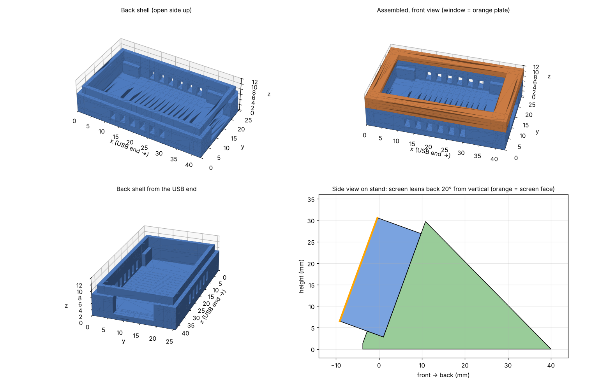

# Stargaze Display

A small desk display that rates the next 6 hours for stargazing, from **0 (terrible)** to **100 (amazing)**.
Built on a Waveshare ESP32-C6 1.47" LCD board, with a 3D-printed case.

## What it shows

The screen flips between two pages every 10 seconds.

**Page 1: Stargaze**
- Big score for the current hour, with a verdict (Terrible / Bad / Poor / Maybe / Good / Amazing!)
- Best hour in the next 6 hours
- Dew risk and seeing
- Colour-coded bar graph for the next 6 hours

**Page 2: Conditions**
- Low, mid and high cloud, rain chance, humidity, wind, temperature, visibility
- Moon illumination and whether it's up
- Dew risk, seeing and transparency
- The factor holding the score back most ("Limiter")
- Last update, next update and WiFi status

## How the score works

Each factor is a number from 0 to 1, and they're multiplied together, so one killer (overcast or rain)
drags the whole score down while small problems only trim it.

| Factor | Source | Effect |
|---|---|---|
| Cloud (low, mid, high) | Open-Meteo | Biggest factor. Thin high cloud counts a bit less |
| Rain chance | Open-Meteo | Up to -80% |
| Moon | Calculated on the board | Only when above the horizon. Brighter and higher = worse, up to -60% |
| Humidity | Open-Meteo | Above 60% trims transparency, up to -30% |
| Wind | Open-Meteo | Above 15 km/h, up to -30% |
| Visibility (haze, smoke) | Open-Meteo | Under 20 km, up to -40% |
| Seeing | 7Timer! | Steps worse than 3/8 trim the score, up to -20% |
| Transparency | 7Timer! | Steps worse than 3/8 trim the score, up to -20% |

The sun is deliberately left out, so the display is still a useful weather summary during the day.
7Timer! is optional: if it's down, the score carries on without seeing and transparency.

7Timer!'s scales run backwards: **1 is best, 8 is worst**. Seeing 3/8 means about 0.75-1 arcsecond, which is good.

## Hardware

- Waveshare ESP32-C6-LCD-1.47 (172 x 320 ST7789, used in landscape)
- USB-C cable and power
- The 3D-printed case in `case/` (optional)

## Software setup (Arduino IDE)

1. Install the **esp32** board package by Espressif (version 3.x).
2. Install these libraries from the Library Manager:
   - **GFX Library for Arduino** (Arduino_GFX)
   - **ArduinoJson** by Benoit Blanchon (version 7)
3. Open `firmware/Stargaze/Stargaze.ino`.
4. Copy `secrets.example.h` to `secrets.h` in the same folder and fill in your WiFi details.
   You can set a second network that's used when the first isn't available.
5. Set your location near the top of the sketch (`LATITUDE`, `LONGITUDE`, `TZ_INFO`).
6. Select the ESP32C6 Dev Module board and upload.

Useful settings at the top of the sketch:

- `BACKLIGHT_PERCENT`: screen brightness (lower is cooler and easier on dark-adapted eyes)
- `REFRESH_MS`: how often to fetch the forecast (default 30 minutes)
- `MOON_MAX_PENALTY`, `HIGH_CLOUD_WEIGHT`, `CLOUD_POWER`, `SEEING_STEP`, `TRANSP_STEP`: scoring weights

All network work runs in a background task, so the display never freezes while it downloads.

## Case

Three parts in `case/`, all in mm, no supports needed:

- `back_shell.stl`: print open side up. Holds the board on its own feet, with a USB-C slot, vents,
  channels for the BOOT/RESET buttons and pin holes to press them.
- `front_bezel.stl`: print face down. Rounded screen window, snaps onto the shell.
- `stand.stl`: print flat. Leans the display back 20 degrees.

`make_case.py` generates all three (Python 3 + numpy). Every dimension is a setting at the top of the file,
for example `WIN_R` for the window corner radius or `SNAP_PROT` for how firmly the snaps grip.

## Data sources

- [Open-Meteo](https://open-meteo.com/): free weather API, no key needed (non-commercial use)
- [7Timer!](https://www.7timer.info/): astronomical seeing and transparency forecast
